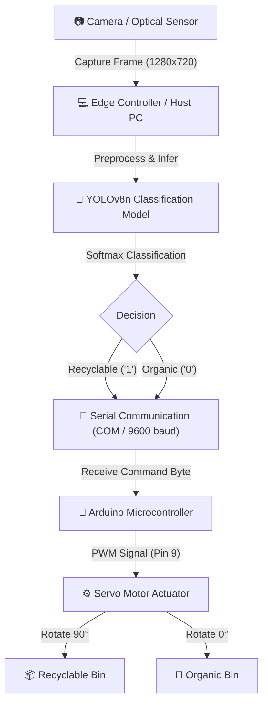

# 🗑️ Smart IoT Dustbin: AI-Powered Automated Waste Segregation

[](https://python.org)
[](https://github.com/ultralytics/ultralytics)
[](https://pytorch.org)
[](https://arduino.cc)
[](https://opencv.org)

An intelligent, IoT-enabled waste segregation system that automatically classifies and sorts waste into **Organic (`O`)** and **Recyclable (`R`)** compartments in real-time. Built using **YOLOv8 deep learning computer vision**, **OpenCV**, and an **Arduino-controlled servo motor mechanism**.

---

## 📌 Table of Contents
- [Overview](#-overview)
- [System Architecture](#-system-architecture)
- [Hardware & Software Stack](#-hardware--software-stack)
- [Repository Structure](#-repository-structure)
- [Hardware Setup & Circuitry](#-hardware-setup--circuitry)
- [Installation & Getting Started](#-installation--getting-started)
- [Model Training & Performance](#-model-training--performance)
- [Communication Protocol](#-communication-protocol)
- [Troubleshooting & Tips](#-troubleshooting--tips)
- [Roadmap & Future Enhancements](#-roadmap--future-enhancements)
- [License](#-license)

---

## 💡 Overview

Improper disposal and manual sorting of municipal solid waste pose significant environmental and health challenges. The **Smart IoT Dustbin** bridges deep learning vision systems with edge microcontrollers to automate waste sorting at the point of disposal:

1. **Object Detection / Classification**: A webcam captures waste placed on the scanning surface.
2. **Deep Learning Inference**: A lightweight **YOLOv8n-cls** model running on the host machine evaluates the visual features and predicts whether the object is **Organic** or **Recyclable**.
3. **IoT Actuation**: The classification decision is transmitted via Serial (UART) to an **Arduino microcontroller**, which activates a servo motor to tilt or divert the sorting flap into the appropriate receptacle.

---

## 🏗️ System Architecture



---

## 🛠️ Hardware & Software Stack

### Hardware Components
* **Microcontroller**: Arduino Uno / Nano / Mega
* **Actuator**: Micro Servo Motor (SG90 / MG996R)
* **Camera**: USB Webcam / Integrated Camera (720p / 1080p)
* **Power Supply**: 5V external power source or USB 5V rail
* **Jumper Wires & Breadboard**
* **Mechanical Bin Enclosure**: Dual-compartment bin with a center flap attached to the servo horn.

### Software Stack
* **Language**: Python 3.10+, C++ (Arduino IDE)
* **Machine Learning**: Ultralytics YOLOv8, PyTorch
* **Computer Vision**: OpenCV (`cv2`)
* **Communication**: PySerial
* **Experiment Tracking**: Weights & Biases (W&B)

---

## 📁 Repository Structure

```
Smart-IoT-Dustbin/
├── README.md                          # Project documentation
├── data.yaml                          # Dataset configuration for classes (O, R)
├── scanner.ipynb                      # Real-time webcam capture & serial sorting pipeline
├── test.ipynb                         # Model validation and prediction evaluation notebook
├── x.py                               # Standalone script for testing Arduino serial communication
├── servomotorworking/
│   └── servomotorworking.ino          # Arduino firmware for servo motor rotation control
├── OUTPUT/
│   ├── yolov8n-cls.pt                 # Base pre-trained YOLOv8 nano classification model
│   ├── runs/classify/train/weights/
│   │   ├── best.pt                    # Fine-tuned model checkpoint (~93.3% Top-1 accuracy)
│   │   └── last.pt                    # Last epoch training checkpoint
│   └── wandb/                         # Weights & Biases run logs and metrics
└── runs/classify/                     # Validation results, prediction samples, and confusion matrices
```

---

## ⚡ Hardware Setup & Circuitry

### Arduino Pin Connections

| Component | Pin / Wire | Arduino Pin | Description |
| :--- | :--- | :--- | :--- |
| **Servo Motor** | VCC (Red) | `5V` (or external 5V) | Servo Power |
| **Servo Motor** | GND (Brown / Black) | `GND` | Common Ground |
| **Servo Motor** | Signal (Orange / Yellow) | `Pin 9` | Digital PWM Control Pin |
| **Host PC** | USB Cable | `USB Port` | Serial Communication (`9600 Baud`) |

> [!NOTE]
> When using high-torque servos such as the **MG996R**, power the servo from an external 5V/2A power supply while keeping a common ground (`GND`) with the Arduino to prevent brownouts.

---

## 🚀 Installation & Getting Started

### 1. Clone the Repository
```bash
git clone https://github.com/shrihari808/Smart-Iot-Dustbin.git
cd Smart-Iot-Dustbin
```

### 2. Set Up Python Environment
Create a virtual environment and install the required dependencies:
```bash
python -m venv venv
# On Windows:
venv\Scripts\activate
# On Linux/macOS:
source venv/bin/activate

pip install ultralytics opencv-python pyserial torch torchvision
```

### 3. Flash the Arduino Firmware
1. Connect the Arduino board to your computer via USB.
2. Open [`servomotorworking/servomotorworking.ino`](servomotorworking/servomotorworking.ino) in the **Arduino IDE**.
3. Select your Board and COM Port under **Tools > Port**.
4. Click **Upload** (Ctrl + U).

### 4. Run Inference & Sorting
Open [`scanner.ipynb`](scanner.ipynb) in Jupyter Notebook or VS Code, verify the assigned `COM` port (e.g., `COM3` or `COM4`), and execute the inference cells.

---

## 📊 Model Training & Performance

The classifier was trained on the Kaggle Waste Classification dataset containing thousands of labelled images partitioned into Organic and Recyclable items.

### Training Configuration
* **Architecture**: YOLOv8n-cls (Ultralytics Nano Classifier)
* **Epochs**: 100
* **Batch Size**: 16
* **Input Image Size**: 192 × 192
* **Hardware Acceleration**: 2 × NVIDIA Tesla T4 GPUs
* **Optimizer**: Auto (SGD/AdamW with Cosine LR schedule)

### Evaluation Metrics
| Metric | Score |
| :--- | :--- |
| **Top-1 Accuracy** | **93.27%** |
| **Top-5 Accuracy** | **100.0%** |
| **Parameters** | 1.44 Million |
| **FLOPs** | 3.36 GFLOPs |
| **Inference Speed (PyTorch)** | ~0.54 ms / image |

Validation confusion matrices and sample predictions are available in [`runs/classify/val4/`](runs/classify/val4/) and [`OUTPUT/wandb/`](OUTPUT/wandb/).

---

## 🔄 Communication Protocol

The host system communicates with the Arduino over a standard 9600-baud UART serial connection using single-byte command ASCII characters:

| Sent Byte | Waste Type | Arduino Action | Servo Response | Serial Reply |
| :---: | :---: | :--- | :---: | :--- |
| `'1'` | **Recyclable (`R`)** | Rotates to 90°, holds 2s, resets to 0° | Opens Recyclable Flap | `"Rotated Right and Returned"` |
| `'0'` | **Organic (`O`)** | Rotates to 0°, holds 2s, resets to 90° | Opens Organic Flap | `"Rotated Left and Returned"` |

---

## 💡 Troubleshooting & Tips

* **Handling Classification Results**:
  Because the model is a classification model (`yolov8n-cls`), access predictions using `result.probs` rather than `result.boxes`:
  ```python
  top_class_id = result.probs.top1            # 0: Organic, 1: Recyclable
  confidence = result.probs.top1conf.item()   # Confidence score (0.0 - 1.0)
  ```
* **Arduino COM Port**: Check Windows Device Manager (or `ls /dev/tty*` on Linux) to confirm which COM port your Arduino is connected to before running the Python script.
* **Camera Index**: If your webcam doesn't open with `cv2.VideoCapture(0)`, try changing the camera index to `1` or `2`.

---

## 🔮 Roadmap & Future Enhancements

- [ ] **Multi-category Sorting**: Expand classes beyond binary classification to include *E-Waste*, *Hazardous*, and *Glass*.
- [ ] **Ultrasonic Bin Monitoring**: Integrate ultrasonic sensors (HC-SR04) to monitor real-time bin capacity and prevent overflow.
- [ ] **Cloud Dashboard / IoT Telemetry**: Send waste metrics and fill levels to an MQTT / cloud dashboard (Blynk, ThingsBoard, or AWS IoT).
- [ ] **Edge Deployment**: Package the Python inference script as a lightweight standalone service on an **NVIDIA Jetson Nano** or **Raspberry Pi 4**.

---

## 📄 License

This project is licensed under the [MIT License](LICENSE) - open for educational and research purposes.
